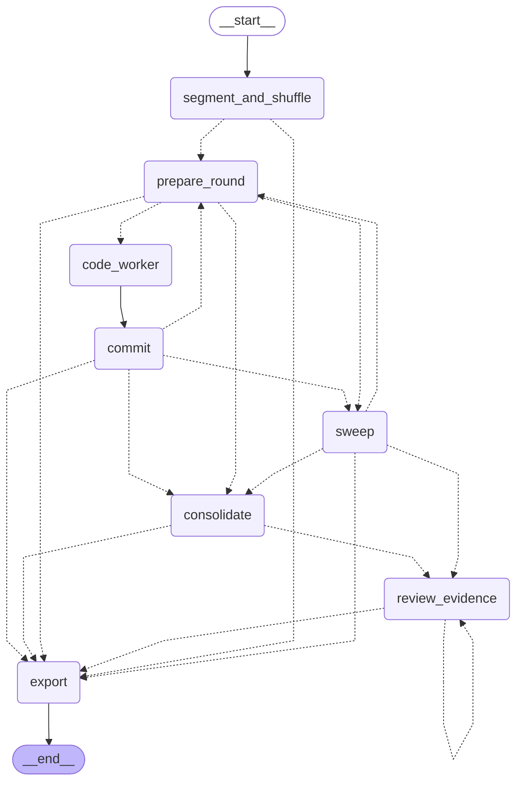
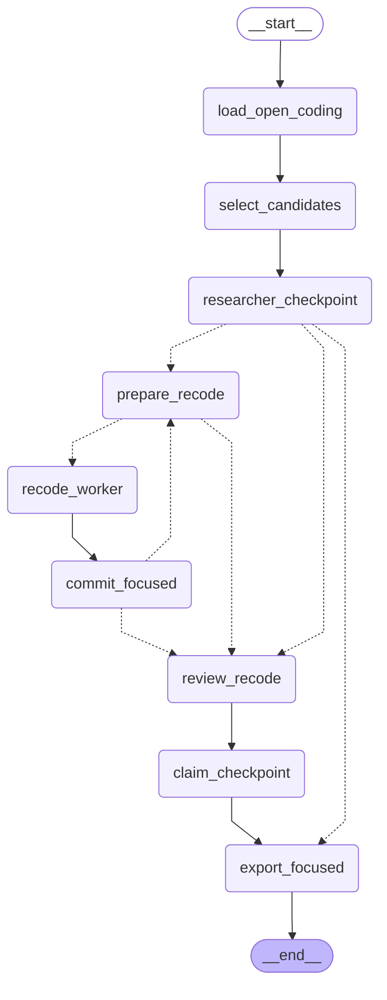
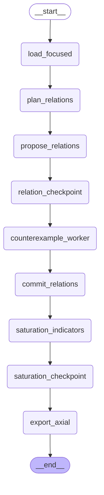
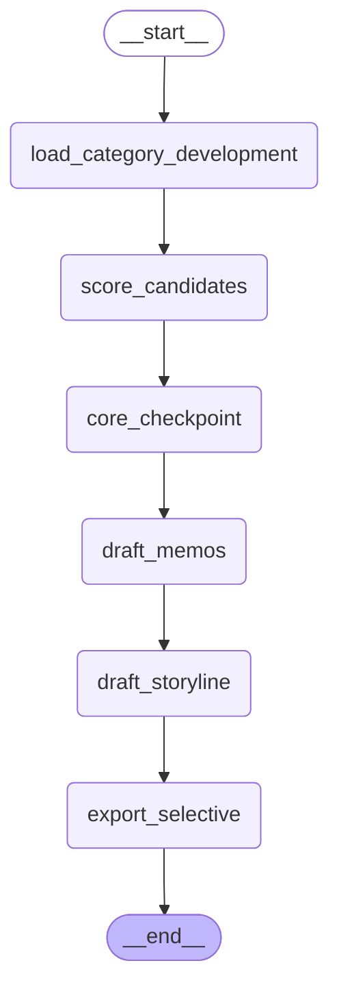

# automated_grounded_theory

**Automated initial (open) coding**, plus a **theme report**, informed by the grounded theory tradition (Glaser and Strauss 1967; Glaser 1978, 1992; Strauss and Corbin 1990/1998; Charmaz 2006/2014). By default the model reads every document in a seeded order, and every passage of that document in reading order, comparing each incident with the codebook earned so far. The package does not do theoretical sampling, axial coding, selective coding, or a saturation decision. How each step maps onto those sources is in [docs/methodology.md](docs/methodology.md). The 0.6 design, including the 0.6.1 corrections, is in [docs/design.md](docs/design.md). A literature-grounded design for the stages after initial coding is in [docs/design-later-stages.md](docs/design-later-stages.md). Focused coding, the first of those stages, is implemented as its own graph. Axial relations, a core category, and a saturation decision from that note are not. A short notebook with the same citations and the Taguette import steps is [docs/open_coding.ipynb](docs/open_coding.ipynb). A full walkthrough on a fictional employee survey, including an offline mode that needs no API key, is [examples/demo.ipynb](examples/demo.ipynb). The notebook writes its outputs to a temporary directory.

`build_themes` is a descriptive grouping of the open codes for reporting. It does not reread the passages and it does not mint codes. Focused coding is not that report.

## How it works

The diagram is the default compiled `open_code` graph from `draw_mermaid()` (`xray=True` draws the same picture, because there are no subgraphs). Sequential, document, wave, pipeline, and parallel-document runs share it; those settings change which passages share a frozen snapshot and when the codebook is written, and `interrupt_before_sweep=True` only marks `sweep` with an interrupt-before breakpoint.

<!-- graph:open_code:begin -->

<!-- graph:open_code:end -->

`segment_and_shuffle` orders the corpus, or goes straight to `export` when there is nothing to code. Each round freezes a snapshot in `prepare_round`, fans out `code_worker` with `Send`, and `commit` is the only writer. Dotted arrows are conditional: a round returns to `prepare_round` until a sweep is due, a sweep returns to `prepare_round` while passages remain, and when the queue is empty `consolidate` reads the codebook once more if at least two codes are still unconsolidated, or the run goes into `review_evidence`, which loops while a code still needs review and the final-review call and token allowances remain, and `export` runs when that review is done, the allowance is spent, or nothing needed review. Document mode (the default) keeps reading order inside a document so later passages see codes committed earlier; wave mode may mix documents in one snapshot; `parallel_documents=True` keeps a codebook per document until a sweep; `pipeline=True` (the default) overlaps the next round with that sweep when more than one request can be in flight, and `strict_sequential_settings()` is this same graph with one passage in flight and the pipeline off.

A PNG of this drawing is [docs/open_code_graph.png](docs/open_code_graph.png). `python scripts/render_graph.py` rewrites this block and the focused, axial, and selective blocks from the compiled graphs.

## Focused coding

Focused coding is a separate graph, `get_graph("focused")`. It reads a finished open-coding run. It does not insert nodes into `open_code` or `themes`. The diagram is `get_graph("focused").compile().get_graph().draw_mermaid()`.

<!-- graph:focused:begin -->

<!-- graph:focused:end -->

`select_candidates` ranks initial codes by assignment frequency, document and respondent spread, and analytic weight. Analytic weight is the mean of the features you leave on: substantive memo count, the in-vivo flag, and a stored model comparison (`refine_definition`, `record_dimension`, `link_to_category`, or `keep_distinct`). It is not an importance score. Memo count can reward a verbose memo. `focused_analytic_features` drops any of `memo`, `in_vivo`, and `comparison`. A researcher pin is included even when the score is low. A rare contrast, the only code on one pole of a dimension already recorded, stays eligible. The lists `raised_code_ids` and `not_raised_code_ids` are a proposal. Nothing is deleted from the codebook.

`researcher_checkpoint` and `claim_checkpoint` are the human checkpoints. Each calls LangGraph's `interrupt()` inside the node. The default checkpointer is `InMemorySaver`. Pass `checkpointer` or `checkpoint_path` to keep the thread. Resume with the same checkpointer and `thread_id`, `resuming=True`, and `resume` set to the value for `Command(resume=...)`. `{"accept": true}` keeps the code proposal. `{"raised_code_ids": [...]}` replaces it. Codes you leave out stay in the book and are not raised. An empty object is not a resume value: LangGraph reads a dict of interrupt ids, and an empty dict matches that pattern. Use `{"accept": true}` or `{"leave_claims": true}`.

```python
from langgraph.checkpoint.memory import InMemorySaver
from automated_grounded_theory import focused_code, read_focused_interrupt

saver = InMemorySaver()
paused = focused_code(
    open_coding_result,
    model=model,
    seed=7,
    checkpointer=saver,
    thread_id="focused-1",
)
payload = read_focused_interrupt(saver, "focused-1")
paused_claims = focused_code(
    open_coding_result,
    model=model,
    seed=7,
    checkpointer=saver,
    thread_id="focused-1",
    resuming=True,
    resume={"raised_code_ids": payload["payload"]["raised_code_ids"], "incidents": [{"passage_id": "p4", "purpose": "compete"}]},
)
finished = focused_code(
    open_coding_result,
    model=model,
    seed=7,
    checkpointer=saver,
    thread_id="focused-1",
    resuming=True,
    resume={"leave_claims": True},
)
```

`agt-focused interrupt --checkpoint PATH --thread THREAD` prints that payload. `agt-focused resume` continues the same thread. The resume value cannot carry a replacement corpus, context, model, or procedure. The call is checked against the manifest stored when the run started: corpus hash, the open-coding source hash, context, model settings, and the analytic procedure. A mismatch raises `CheckpointMismatch`. `allow_changes=True` or `continuation=True` records the old and new values and continues. Corpus identity and `seed` are not continuable (`CheckpointMigrationRequired`).

Performance settings are a separate manifest block. `batch_size` (default 1) is how many passages share one recode request. `concurrency` caps in-flight calls. `token_budget` (default 6000) bounds that request. They do not change which codes the score proposes. Changing them on resume is a continuation, not a change of analytic procedure, and still needs `allow_changes` when the checkpoint already exists.

`prepare_recode` splits the allowance across four shares that sum to 1. `develop`, `compete`, and `outside` are interleaved. `focused_share_claim_compete` is reserved and is not spent on that queue. The default is one quarter each. A caller that still passes three shares summing to 1 keeps the claim-compete share at 0. Each of the first three queues is sized to its reserved share of `max_focused_review_calls`. `focused_neighbor_limit`, `focused_outside_limit`, and `focused_negative_case_limit` are optional caps: `None` (the default) does not cap the source, and `0` adds none from it. They are not a default of one passage. `develop` rereads passages already assigned to a raised code. `compete` tests competing interpretations before any property claim exists: the same code with a different valence or consequence, a low-confidence or flagged assignment, another code on the passage, or an opposite pole, then within-category negative cases and lexical neighbors. After properties are written, the reserved claim-compete share tests a claim only against a passage that claim retrieved. Sharing the category is not enough. The passage also needs overlap with the claim's evidence (its pole, text, or quote, not the code label): at least two content tokens, or a stored embedding at or above 0.55. Opposite-pole wording and hedges or exceptions about that evidence are preferred, because the round is looking for counterevidence. An empty quote is not sent. Same-category pairs with no overlap, and pairs with only weak overlap, are skipped and logged, and those calls are reallocated to compete or outside. `claim_test_relevance` reports queued and skipped counts and how many judgments were on-point (`relevance_rate` is null when nothing was judged). A pole that is an absence of mention (`no mention of ...`) is flagged `degenerate_absence_pole`, kept, and not used to generate a test. The prompt says `contradicts` only when the passage asserts the opposite; if the passage does not mention the claim, the judgment is `irrelevant`. Only a `contradicts` or `qualifies` from a relevant test is a negative case, flagged and not applied, and the claim's `evidence_condition` becomes `disputed`. Any other `contradicts` or `qualifies` is stored and flagged `claim_test_invalid` and does not dispute the claim. The worker keeps the requested `(passage_id, claim_id)` pairs. A returned pair that was not requested is `claim_test_invalid` with reason `unrequested_pair`. A quote is required only for supports, contradicts, or qualifies; if that quote does not anchor, the reason is `unanchored_quote`. An irrelevant judgment with an empty quote is valid. It is kept in the prompt log. It is not a negative case and it does not change `evidence_condition`. `supports` against a shortfall pole is `possible_direction_mismatch`, a diagnostic that asks for inspection, not automatic `claim_test_invalid`. A paraphrase such as `visits too rarely` is not a mismatch. A shortfall phrase in a clause about something else does not suppress it. The judgment is kept. `claim_support` stays undefined. supports and irrelevant are not code changes. `claim_support` stays undefined. `claim_test_counts` accumulates every judgment in the run. Calls that do not find a relevant passage are sent as outside or compete calls, on the recode or compete schema, not the claim-test schema. `outside` examines passages outside that selection. When the outside cap is positive and that list is empty, the lowest-confidence raised assignments fill it. A purpose that gives its calls to another purpose is marked reallocated. A reserved share that is not sent and not given away is unused. The warning denominator is the call allowance. `purpose_coverage.reallocation.reallocated` is true only for a real transfer. `purpose_coverage` reports claim compete with the others, including the share of calls actually used (`applied_share`). `seed` shuffles order. When every candidate fits its slot, `seed` does not change who is included. `focused_sampling_seed` chooses membership only when a candidate list is longer than its slot. A researcher incident, from the resume value or `focused_incidents.csv` (`passage_id`, `purpose`), can enter develop, compete, or outside and is not dropped to meet a cap.

`recode_worker` rereads a frozen snapshot. Develop and outside see the full codebook, raised codes and the others, and are told to prefer an existing code. Compete and claim compete list every code on equal footing, alternatives first, with no raised mark. Each compete passage must return a `keep`, `revise`, or `drop` verdict with a rationale for every initial code, and a required `strongest_alternative`. `commit_focused` is the only writer. An initial assignment the reread does not repeat is kept and flagged `focused_disagreement`. `revise` and `drop` are flagged proposals (`focused_revise_proposal`, `focused_drop_proposal`) and are not applied without review. Within a run they are consolidated per code. A code with both a revise and a drop, or two different revised definitions, is `proposal_conflict`: unapplied, flagged, and excluded. `actor` stays `model` whether the checkpoint decision mode is human or LLM. `proposal_stability` compares the codes and `(code_id, passage_id, property_key(definition))` across runs and is empty on one run. A drop with an empty definition matches a revise of the same code and passage. `cross_seed_conflicts` lists kind or definition disagreements. A segment list is not treated as proposal rows. A run folder is read from `coded_segments.json` or `focused_run.json`. Unrecognized input raises. A pair of runs with no proposals is not scored as identical. If there are no proposals to compare, both scores are undefined. A compete round that returns only `keep` sets `compete_keep_only` and a warning. Exclusion and consolidation do not remove a non-conflicting revise or drop. Those proposals are stored before the alternative check. The prompt says `keep` is not the default. Each compete passage sets `alternative_fit` to `weaker`, `comparable`, or `stronger`. A kept raised code is flagged `alternative_named_not_chosen` only when that fit is `stronger` for a different code. Naming an alternative, or mentioning one in the memo, is not enough. A `strongest_alternative` that names the kept code, or a code already assigned on the passage, is flagged `alternative_is_kept_code` and recorded as invalid. The prompt lists `allowed_alternatives` and `excluded_alternative_code_ids`. A `code_id` and a label that do not name the same code are `alternative_id_name_mismatch`. An empty `code_id` with a novel label that is not an excluded label stays a non-codebook alternative. The same span is a confirmation on the existing assignment. A different span is nested on that assignment as a span proposal, not a second row in `assignments.json`. A proposal that drops words of the original quote is flagged `narrowed_span`. A new code whose label and definition are lexically close to an existing code (`focused_duplicate_similarity`, default 0.5) is flagged `possible_duplicate`. A quote that is not in the target passage is kept. If it is found in another passage, that passage is the attribution and the row is flagged `evidence_outside_passage`. If it is found nowhere, it is flagged and not assigned to a different passage. It is not dropped.

Properties and dimensions are written to `category_development.json` (`state_version` 1). Properties that share a category and a normalized `property_key` merge into one row and keep every citation. Each folded row is kept as a constituent (`entry_id`, name, text, pole, document, passage, quote). The same key with a different non-empty text or pole is flagged `property_merge_conflict`, kept out of `downstream_claims.json`, and still listed with those constituents. `property_key` sorts the content words and drops function words, so `timing of departure` and `timing during departure` match `departure timing`. A low name-level score means the remaining words differ. `category_counts`, `name_counts`, and `properties_per_run` are the set sizes. A low score with many names means the runs named different properties. The score is reported. It is not claim support. `property_stability` on the result records those keys. Category-level and name-level scores compare two or more runs and are empty on a single run. `property_stability(runs)` is that comparison. It is not claim support. `relations` on the focused export stays null. Axial coding writes `category_relationships.json` from its own graph. Loading this state does not require an axial run. Each row keeps a disposition (`proposed`, `accepted`, `rejected`, `superseded`), an evidence condition (`anchored`, `disputed`, `insufficient`), and `downstream_eligible` (accepted, anchored, not `needs_review`, human `claim_support` not `contradicted`, and not a `property_merge_conflict`). `claim_support` stays `undefined` until a researcher sets `supported`, `partially_supported`, `contradicted`, or `indeterminate`. A contradicted claim is stored and excluded from `downstream_claims.json`. An LLM reviewer does not write `claim_support`; it writes `model_claim_support`. See [Human-guided or LLM-driven review](#human-guided-or-llm-driven-review). Citation anchoring, the share of quotes that locate a span, is a separate report. It is not claim support. `category_match` sits beside it: a property whose category is not assigned on the cited passage is flagged `property_category_mismatch`. Anchoring is not category fit. Each row cites `category_revision_id` and `evidence_revision_id`. A category edit keeps the old text in `revision_history` and marks dependent claims and assignments `needs_review`. `category_development.json` and `focused_claims.csv` list every row. `downstream_claims.json` lists only eligible rows, and the file says so. `code_id_sidecar.json` maps Taguette tags to stable code ids. A label change is a rename only when an approved mapping says so. Otherwise a missing tag is kept and flagged `researcher_removed`, and a new tag is `ambiguous`.

Revise and drop proposals stay unapplied. A run with `interrupt` false does not pause, so a disputed claim can stay pending. `claim_checkpoint` pauses after the reread when `interrupt` is true. `{"leave_claims": true}` keeps dispositions proposed. `{"accept_claims": true}` accepts anchored proposals. `{"claim_reviews": [{"entry_id": "...", "claim_support": "supported"}]}` records the researcher label. `{"category_edits": [{"code_id": "...", "definition": "..."}]}` revises a category without erasing dependents.

`max_focused_review_calls` (default 8) and `max_focused_review_tokens` (default 24000) are ceilings, not measured costs. Calls are checked first, then the pre-call token estimate (`focused_tokens_estimated`). `focused_tokens_used` and `provider_token_usage` record provider-reported input, cached, and output tokens when the response includes them. The estimate is not provider usage. Zero on either still runs the selection and, when `interrupt` is true, still pauses, then skips the model. Passages that were queued and not sent are `focused_not_reread`. Passages that never entered the queue are `focused_not_queued`. Status `complete` means every corpus passage was reread. Status `complete_for_queue` means the queue finished and states that coverage; it is not corpus coverage. Status `incomplete` means the allowance, a no-progress stop, or a timeout cut the queue short (`call_allowance`, `token_allowance`, `no_progress`, or `timeout`). A timeout returns that incomplete result, including a partial export when an output directory is set. `raise_on_timeout=True` raises `TimeoutError` instead. `focused_calls_used` counts calls written to the prompt log, not a job that was only prepared. `focused_not_reread` lists queued passages that were not committed, including after a timeout. `focused_synthetic_counterexample=True` injects one passage labeled `[synthetic counterexample]` so a live eval can check that a contradiction is detected. That passage is not research data and is omitted from research exports. `focused_request_timeout` (default 120 seconds) is a wall-clock budget for one model call, including streaming and retries. The deadline is a dedicated thread waiting on a monotonic clock. It does not wait on the call's future and it does not sleep on an asyncio loop. When it expires, the model loop is abandoned and the waiter is unblocked even if that loop never resumes. Timed calls share one model loop until a call fails to finish. The abandoned thread is not killed. `process_isolation=True` runs a picklable provider in a subprocess that is terminated at the timeout. A pooled httpx client is constructed on the loop that uses it, and an httpx client the SDK builds during the call gets a socket timeout slightly past the deadline. httpx 0.28 does not expose the pool's loop, so a client that already served a request on another loop is not reused. Callers do not keep the client alive. The provider client still bounds connect, read, write, and pool. A graph step that calls the model has its own watchdog: two request timeouts plus two seconds for a recode step (the call and a label retry), and the decision allowance for an LLM checkpoint. On expiry the task is cancelled and `TimeoutError` is raised even if the provider swallows cancellation or leaves the connection open. The message keeps that attempt's duration. It is not rewritten as the sync-bridge budget. A timeout is retried only when the wall budget can hold another full request timeout, and that retry is counted in the message. The deadline runs on its own thread. A pooled client bound to another loop is rebound onto the model loop, with connect, read, write, and pool timeouts, so a silent body cannot sit on an idle loop. The checkpoint records stop `timeout`, status `incomplete`, `timeout_step`, and a partial export when an output directory is set. A watched step does not retry the node timeout. `focused_request_retries` (default 4) is the retry cap inside that budget. Zero timeout waits with no deadline and stays on the caller's loop. The sync bridge is the allowance times one request timeout, plus one second, and that wait is also `future.result`. It is not itself the request timeout. `focused_tokens_estimated` is a heuristic of about three characters per token, not a guaranteed ceiling and not provider usage. It is what stops the reread. `focused_tokens_adjusted` (also stored as `focused_tokens_calibrated`) divides that heuristic by 1.28. The divisor is the v23 condition, where the heuristic divided by provider total tokens was about 1.27 to 1.29. On the v24 live eval the raw heuristic divided by provider input tokens was about 1.38, and the adjusted figure was reported within 0.3% of those input tokens. Neither number is a general calibration, and the adjusted figure is not the stopper. `provider_token_usage` keeps input, output, and cached counts separate. `token_estimate_ratio` is the heuristic divided by provider `input_tokens` when those were reported, and null otherwise. Work already written stays. `saturation_report["judgment"]` stays null. This stage does not set it.

Weights are `focused_weight_frequency`, `focused_weight_documents`, and `focused_weight_analytic` (each default 1). `focused_selection_rule` defaults to `top_k`: the upper half of the book, ties broken by `code_id`, and not every code. `quantile` uses the same ceiling. `focused_raise_all` is the opt-in that raises every code. An explicit `focused_min_score` is a hard threshold. The result warns when the raised fraction reaches `focused_raise_warn_fraction` (default 0.75). Focused coding `coding_lens` accepts `charmaz` only. Axial coding is a separate graph and defaults to the paradigm lens. The output folder includes `coded_segments.json`, `assignments.json`, `prompt_log.json` (with the raw model response), `focused_claims.csv`, and `downstream_claims.json`. `scripts/evaluate_focused.py` compares initial coding with a focused reread offline and prints a live-cost estimate. It does not call an API. The plan is in [docs/focused-evaluation.md](docs/focused-evaluation.md).

## Axial coding and saturation

Axial coding is `get_graph("axial")`. Selective coding is `get_graph("selective")`. Neither graph is inserted into `open_code`, `themes`, or `focused`. The default run is still initial coding plus a theme report. `judgment` stays null. The design is [docs/design-axial-0800.md](docs/design-axial-0800.md).

<!-- graph:axial:begin -->

<!-- graph:axial:end -->

`propose_relations` asks for a relationship on each planned pair and cites a passage. `relation_checkpoint` calls `interrupt()` when `decision_mode` is `human`. Resume with `{"accept": true}`, `{"leave_relations": true}`, or `{"relationships": [{"relationship_id": "rel-0001", "action": "accept|revise|reject|merge", "paradigm_role": "context", "merge_into": "rel-0002", "label": "clearer label"}]}`. An empty object is not a resume value. A merge keeps both rows. The kept label is the target statement, or `label` when the researcher supplies a clearer one. `claim_support` stays `undefined`.

`counterexample_worker` queues a passage only when it shares two content tokens with the statement and quote, a stored embedding at or above 0.55, or a hedge or exception that also shares a token. One token is skipped and logged. Verdicts are `supports`, `contradicts`, `qualifies`, and `irrelevant`. A quote is required only for the first three. A valid `contradicts` or `qualifies` sets `evidence_condition` to `disputed` and keeps the row. `axial_synthetic_counterexample=True` injects one passage labeled `[synthetic counterexample]` and omits it from research exports.

`saturation_checkpoint` reports the curve and does not set `judgment`. Resume with `{"decision": "not_claimed|sufficient_for_this_question|not_saturated", "rationale": "..."}` or `{"leave_saturation": true}`. Fewer than two documents leaves code-frequency stabilization undefined, and so does a document with no assignments. The figure is total variation between consecutive documents' normalized assignment counts. It describes how those documents differ. Low variation does not establish theoretical saturation, and it is separate from a human confirmation. A 0.8.0 presence-bit report is not comparable. One run leaves cross-run stability undefined. `decision_mode="llm"` writes `model_saturation` with `model_judgment` true and does not write `researcher_saturation`.

`max_axial_review_calls` (default 8) is split by `axial_share_propose` and `axial_share_counterexample` (default 0.5 and 0.5). The shares are model calls. Proposal calls needed are `ceil(pair_count / batch_size)`. Only unused calls move to the counterexample share, and that share can test `calls * batch_size` pairs. `max_decision_calls=0` sends no reviewer call. Coding calls and reviewer calls are separate ceilings. They share `max_axial_review_tokens` (default 24000). A repair spends the stage that sent the first request. `axial_token_budget` (default 6000) bounds one request. Provider input, output, and cached tokens are recorded on each response, including a repair that fails to parse. The consumed allowance is checkpoint state, so a human pause does not reset it. `batch_size` stays 1 unless you set it. It is a performance setting. `axial_request_timeout` uses the monotonic deadline, including work before the first model call. A timeout returns an incomplete result unless `raise_on_timeout=True`. `also_selective=True` keeps the axial prompt log and saturation assessment. Selective export does not rewrite the axial JSON files. A run is `complete` only when every requested stage finished; otherwise it is `budget_limited` or `incomplete`, with a status per stage.

## Selective coding

Selective coding reads category development, or the axial result, and can run on its own.

<!-- graph:selective:begin -->

<!-- graph:selective:end -->

`score_candidates` counts centrality twice, once for proposed relationships and once for relationships a researcher has accepted. It does not pick a winner. `core_checkpoint` resumes with `{"core_id": "...", "rationale": "..."}` or `{"leave_core": true}`. Alternatives stay in the list. `decision_mode="llm"` writes `model_core_id` and leaves `researcher_core_id` empty. `include_memos` and `include_storyline` are off unless requested. A memo with no text is kept and flagged `memo_empty`. A storyline statement without an anchored quote is kept and flagged `storyline_uncited`. `theory_coverage.json` reports rates that are null when there is nothing to score. `max_selective_review_calls` is a separate ceiling.

## Human-guided or LLM-driven review

`decision_mode` is `human` or `llm`. The default is `human`: `researcher_checkpoint` and `claim_checkpoint` still call `interrupt()`, and you resume them yourself. `decision_mode='llm'` uses a bounded reviewer for those two checkpoints and does not interrupt. `decision_model` is the reviewer. It is allowed only in `llm` mode and defaults to the focused-coding `model`. Model support is stored as `model_claim_support` (`supported`, `partially_supported`, `contradicted`, `indeterminate`). Human `claim_support` stays `undefined` until a person sets it. A model `contradicted` label rejects the claim. A model `accepted` disposition is kept only when model support is `supported`. The saturation judgment stays null.

Each LLM decision records `review_actor` (`llm`), `review_model`, `review_rationale`, and appends `review_history`. A human `claim_support` label records `review_actor` `human` and appends that label to `review_history` without copying it into `model_claim_support`.

Decision calls do not retry inside this package. `max_decision_calls` (default 8), `max_decision_tokens` (default 24000), and `decision_token_budget` (default 6000) are independent ceilings. The token allowance counts estimated input tokens. A request larger than `decision_token_budget` is not sent. Claim review packs against the minimum of `decision_token_budget` and the remaining token allowance. A batch that is only too big together is shrunk. One claim larger than the request budget stops as `decision_request_budget` (`decision_stop_detail` `single_claim_exceeds_request_budget`). One claim that fits a request but not what remains stops as `decision_token_allowance`. The reviewer receives the claim's passage and passages cited by negative cases, claim tests, and other citations, deduped, within an evidence-character budget. Passages that do not fit are `omitted_context`. When a ceiling, a request budget, an invalid decision, or a reviewer error stops the review, status is `incomplete`, `stop` is `decision_<reason>` (`decision_call_allowance`, `decision_token_allowance`, `decision_request_budget`, `decision_invalid_decision`, or `decision_review_error`), and `decision_pending_claim_ids` lists claim entry ids that were not reviewed.

An empty `raised_code_ids` list is a selection, not a missing one. It is stored as empty, and the reread is skipped. Resuming a paused run with a different `decision_mode` is a procedure change: pass `allow_changes=True` (or `continuation=True`). Corpus identity and `seed` are still not continuable. `decision_model` on a human run raises `ValueError`.

```python
finished = focused_code(
    open_coding_result,
    model=model,
    decision_mode="llm",
    decision_model=model,
    max_decision_calls=8,
    max_decision_tokens=24000,
    decision_token_budget=6000,
    interrupt=True,
)
```

`agt-focused resume` accepts `--decision-mode`, `--decision-model`, `--max-decision-calls`, `--max-decision-tokens`, and `--decision-token-budget`. `--resume` is required in human mode. In `llm` mode the resume value can be omitted; the reviewer decides, and `--allow-changes` is required when that mode differs from the paused run.

## Install

```bash
pip install automated_grounded_theory
```

Coding uses a LangChain chat model. Install the extra for the provider you actually call:

| Extra | Provider |
| --- | --- |
| `xai` | Grok / xAI (`langchain-xai`) |
| `openai` | OpenAI |
| `anthropic` | Anthropic |
| `google` | Google Gemini |
| `mistral` | Mistral |
| `groq` | Groq (the inference host, not Grok) |
| `ollama` | Ollama |
| `azure` | Azure OpenAI |
| `aws` | Bedrock |
| `cohere` | Cohere |
| `huggingface` | Hugging Face |
| `checkpoint` | SQLite resume (`langgraph-checkpoint-sqlite`) |
| `plots` | Theme prevalence chart (`matplotlib`) |
| `viz` | Graph drawing (`grandalf`). Optional `pygraphviz` needs a Graphviz install and is not in the extra. |
| `taguette` | The Taguette package (`taguette>=1.5`) for a caller who imports it. This package still does not write a Taguette SQLite project. |

```bash
pip install "automated_grounded_theory[xai]"
```

No provider is the default, and none is imported until you name it.

## API key

Pass `api_key` or leave it unset. If you leave it unset, the provider SDK reads its own environment variable. This package does not contain a key.

For Grok, create a key in your [xAI account](https://console.x.ai/) and export it:

```bash
export XAI_API_KEY="..."
```

`langchain-xai` reads `XAI_API_KEY` when you do not pass `api_key`. Other providers use their own variables (`OPENAI_API_KEY`, `ANTHROPIC_API_KEY`, and so on).

## Usage

```python
from automated_grounded_theory import open_code

result = open_code(
    corpus=["interviews/alex.txt", "interviews/blair.txt"],
    context={
        "research_question": "How do students describe the days around leaving home?",
        "population": "Undergraduates in their first term",
        "sensitizing_concepts": ["leaving home"],
    },
    model="xai:grok-4",
    sweep_model="xai:grok-4",
    seed=7,
    sweep_every=25,
    unit="incident",
    batch_size=1,
    concurrency=4,
    output_dir="coding_run",
    checkpoint_path="coding_run/checkpoints.sqlite",
)
```

`model` is a `provider:model-name` string, passed to LangChain `init_chat_model`, or a `BaseChatModel` you built yourself. `sweep_model` defaults to the same model. A blank string is the same as omitting it. `embeddings` is optional. When it is omitted, merge candidates are lexical and the sweep is still a chat-model call. You only need a chat model to run. Cached vectors are keyed by the model, a fingerprint of dimensions and endpoint, and the sha256 of the exact text, so the same model name at 3 and 5 dimensions does not share a vector. A returned vector whose width does not match that configuration is not stored.

Models this package builds from a `provider:model` string get `timeout=120` seconds (`request_timeout`). A `BaseChatModel` you pass in is not modified; the same deadline still wraps each coding call. Sweep calls use `sweep_timeout` (300 seconds) when that is longer than the coding deadline. `request_timeout=0` waits with no deadline, and the sweep then waits with no deadline too. Timeouts and connection errors are retried with full-jitter backoff, the same as rate limits. Only a rate limit lowers the concurrency ceiling.

```python
from langchain.chat_models import init_chat_model

coder = init_chat_model("anthropic:claude-sonnet-4-5", temperature=0)
result = open_code(corpus, context, model=coder, seed=7)
```

`context` may be a question string or a mapping with `research_question`, `population`, `setting`, `sensitizing_concepts`, and `notes`. Sensitizing concepts steer attention. They are not codes. A mapping that includes `codes`, `codebook`, `tags`, or a coding paradigm raises `PresetCodesError`.

A corpus item can be a mapping with `text` or `path`, optional `id` / `name`, and optional `metadata` (department, tenure, and anything else about the respondent). Metadata is copied onto each segment and into `highlights.csv`. It is not a code, and the model is told not to put it in labels or definitions.

`unit` defaults to `incident`: an interviewer question plus the full answer, split into incidents of about 150–800 characters on sentence boundaries, never mid-answer, and capped near 1,200 characters. `paragraph`, `sentence`, `line`, and `speaker_turn` remain available. Each incident keeps document id, character offsets, the question, and neighboring text. Empty or whitespace text stays in the passage list with `exclusion_reason` `empty` and is not sent to the model. Uncertainty, refusal, `n/a`, and punctuation-only replies are coded (`code_nonsubstantive=True`, the default) and flagged `nonsubstantive` with `nonsubstantive_kind` (`uncertainty`, `refusal`, `non_answer`, or `no_substantive_text`) so they can be filtered. The prompt asks the model to code them from the question, for example "expressing uncertainty about pay" or "declining to answer about staffing". Set `code_nonsubstantive=False` to exclude those replies with `exclusion_reason` instead. A quote that is not verbatim is kept and flagged (`quote_status`: exact, normalized_match, fuzzy_match, possibly_modified, unanchored).

`review_mode` defaults to `document`. Documents are shuffled with the seed. Passages inside a document stay in reading order and are coded with that document's neighbors. `review_mode="wave"` may code passages from several documents in one step against one frozen snapshot. That weakens constant comparison (Glaser and Strauss 1967): a later passage can be coded before an earlier one, and new codes are invisible to the rest of the wave. Use it only when you have accepted that tradeoff. `parallel_documents=True` is a second opt-in that gives each document its own codebook until a sweep. It is off by default.

Three settings control the schedule, and they do different jobs. `passages_per_request` (alias `batch_size`, default 1) is how many passages share one model call. `max_concurrent_requests` (alias `concurrency`, default 4) caps in-flight calls. It does not change which passages see which codebook. `token_budget` (default 6000) caps each coding call. The count is the request that will be sent: instructions, the codes retrieved for every passage in the call, neighbors, metadata, the passages, the JSON schema, a short repair allowance, and room for the answer. A batch that does not fit is split into fewer passages and retrieved codes are trimmed. A passage is split on whitespace only when the text itself still does not fit, or sent alone with a warning when no slice fits. A schema repair is measured again against the same budget. Validation feedback is bounded and shortened until the retry fits. A coding call or a repair that is still over the budget is sent, with a warning and an `oversized_request` flag (passage id and estimated size) on the run metadata and the review list. `passages_per_codebook_update` (default: the same as `passages_per_request`) is how many passages are coded before the codebook is committed. Above 1, each round takes the next incident from a different document, in the seeded order, and does not hold two adjacent passages from one document unless that document is the only one left. The round shares one frozen snapshot. Before the commit, one comparison call aliases new codes from that round when they are the same concept, and leaves the others distinct. `4` is the next request size to compare; do not start at 8.

`strict_sequential_settings()` or `procedure="strict_sequential"` is the sequential baseline: `review_mode="document"`, one passage per request, one request in flight, commit after every passage, `pipeline=False`, and `parallel_documents=False`. Later passages in a document see codes committed from earlier passages. Raising concurrency does not turn that into a wider frozen window. The default schedule is already a window of one passage, so concurrency does not speed up a default run. A faster run sets `passages_per_request` or `passages_per_codebook_update` above 1, or uses wave mode. Those choices share a frozen snapshot across more than one passage, which is a constant-comparison tradeoff.

A 429 halves the in-flight ceiling. Coding, sweeps, and evaluation share that one gate, including batched calls, so concurrent batches cannot each open their own ceiling. `metrics.max_in_flight` is the peak that held a slot. Transport retries use full jitter. `Retry-After` cannot exceed `max_backoff`, and the slot is released during the wait. Schema repair (`REPAIR THIS OUTPUT`) is a separate single attempt and is not a transport retry. Its token usage includes the failed response and the repaired one. Cache keys include the snapshot id, definition revision, evidence revision, and policy version. Run metadata includes an in-flight timeline (`metrics.activity`). Coding time is wall time (`stage_seconds.coding`), per-request latency (`metrics.coding_seconds`), and queue wait (`metrics.coding_queue_wait_seconds`). A batch duration is not added once per passage. `tokens_per_minute` reserves estimated input plus output and then reconciles to actual usage. A reservation larger than the bucket raises `OversizedReservation` instead of waiting. `allow_oversized=True` waits until the bucket is full and then drains it. `requests_per_minute` is the separate per-request bucket. Coding calls use `request_timeout` (120 seconds). Sweep calls use `sweep_timeout` (300 seconds) when that is longer.

`pipeline=True` (the default) runs synthesis of the passages just coded while the next document or wave is coded against the pre-merge snapshot. That is one step of lag: those passages do not yet see the merged labels. The merge map is applied when the sweep returns, in chunk order. The surviving label is the one the model kept as the target. A trivial merge, or directions that conflict inside one component, keeps a deterministic lexicographic tie-break. Aliases and provenance stay on the survivor. Async entry points are `aopen_code`, `abuild_themes`, `aevaluate`, and `amulti_seed_stability`. The sync wrappers reuse one background event loop and do not close HTTP clients the model still holds, so `build_themes` can follow `open_code` on the same model. Inside a notebook they still run on that loop rather than the notebook's.

`parallel_documents=True` codes each document on its own codebook and merges them at sweeps. It is off by default, because passages then do not see each other's new codes until the next sweep. `concurrency` caps how many documents are coded in one wave.

`interrupt_before_sweep=True` stops before a sweep so you can read the codebook. Resume with the same `checkpoint_path` or `checkpointer`, the same `thread_id`, and `resume=True`.

```python
from automated_grounded_theory import multi_seed_stability

report = multi_seed_stability(corpus, context, seeds=[1, 2, 3], model="xai:grok-4")
```

The report is label overlap across seeds, plus the Adjusted Rand index of passage partitions and `aligned_assignment_agreement` (mean Jaccard of each passage's code set after labels are aligned by exact text or a spelling variant, and Krippendorff's alpha on that matrix). A negation does not align. `mapping` records a reviewed equivalence. Adjusted Rand scores 1.0 when every passage has its own code, even if the codes differ. The aligned score does not. The report does not pick a winner.

A later decision model can be passed as `code_retriever` if it implements `rank(passage, codebook, k) -> labels`. Nothing like that ships in this version. Coding and sweeps are chat-model calls.

## What the model is asked to do

For each passage the model says which code each incident indicates, and whether that code is already in the book. One passage can receive several codes, one per distinct incident. Codes should be short gerunds, close to the quote (Charmaz), and they have to come from the participant's language. The research context only sensitizes attention. It is not a source of labels. Before settling on a gerund, the model is asked to look for a vivid participant phrase. `in_vivo` is true only when the label is a contiguous copy, the words are a metaphor, a repetition, or a coined phrase, and a gerund would lose that point. The prompt includes "Pay. Pay. Pay." and "feels like a number", and "I like my team" coded as "expressing liking for the team" with `in_vivo` false. The nearest existing codes, retrieved by embeddings when you pass them and otherwise by label overlap, are listed on the passage. Before a new code the model has to name one of those and why it does not fit. Reuse or refinement is preferred. Definitions stay at the level of the incident: respondent attributes and the question wording do not belong in them. A memo is a free-form analytic note. Write one when something analytically interesting happens. A comparison, a property or dimension, and a question are useful and not required. About 20 to 400 words is a comfortable range. A shorter note is kept and flagged `thin`. A placeholder ("none", "n/a", a sentence that only says nothing was recorded) is omitted. A memo is not dropped for failing a template. `evaluate_run` reports `code_reuse_pct`, the share of segments that reuse a code already applied earlier.

A plain check then runs, with no model:

- a quote is anchored, never dropped: exact, normalized (whitespace, case, punctuation), fuzzy (small edits, with a similarity), possibly modified, or unanchored. `...` can match several spans. Search is the passage, then neighbors, then the document. Possibly modified and unanchored quotes are flagged and coding continues
- a semicolon-joined label is split into separate codes, and a piece that matches an existing code is reused
- an empty label, a label over the length limit, or a new label that bundles several concepts (a comma list of three or more, or several concepts joined by "and") is retried once with feedback. If it is still invalid, the code is kept and flagged for review. A blank label is stored as `(empty label)`
- generic labels (`experience`, `theme`, `discussion`, ...) are dropped
- an in-vivo flag is cleared when the label is not in the passage
- a non-gerund label is kept and flagged, unless `require_gerund=True`
- a new code with no nearest code, or a definition that repeats respondent metadata, is kept and flagged for review

Code-management calls send Pydantic JSON (stable ids for passages, codes, hints, and themes) and return Pydantic decisions. Every decision carries `confidence` from 0 to 1 and a `rationale` of one to three sentences. That score is the model's own diagnostic. It is not a probability and not a calibrated frequency. A coding action below `review_below` (default 0.5) is applied, flagged `needs_review` with reason `low_confidence`, and kept on `review.json`. An in-vivo flag, a definition rewrite, a theme assignment, or a tension below `review_below` is written to `review.json` and is not applied. A merge below `min_merge_confidence` (default 0.5) is not applied either. One sweep call proposes the merge, checks the rubric (same action, same object, and a contrast check), and rewrites the survivor label and definition from the member quotes. Stance is recorded and is not a merge veto. A quote that does not fit is split back out. Labels that differ only by spelling or inflection (case, punctuation, whitespace, plural or gerund forms) and whose definitions are compatible merge without a model call. A negation or a polarity difference never does. Other lexical near-duplicates, including Jaccard at least 0.8, are only proposed and go through the definition and evidence comparison. Valence is stored and is not a merge veto. Both valences stay on the decision. A chain of similar pairs is merged only when every pair in that component was judged. Each pair is decided once per run, keyed by the sorted code ids. A later sweep revisits it when a definition's text or revision changes, or when that code's examples or assignments change. Token overlap is not a threshold. At most `max_merges_per_sweep` merges (default 12) are applied in one sweep; the rest wait on the review list. After the last document, a consolidation sweep reads the codebook again in sorted chunks. The saturation curve reports new codes before merges and the net change after merges. A new label whose content words mostly restate the research context is flagged for review. Pass `check_model` when you want a cheaper model to double-check quote fit and context leakage. `evaluate_run` reports the confidence distribution. `run_metadata.json` records seconds spent coding, sweeping, rewriting, and, from the later stages, building themes and evaluating. Taguette CSVs stay on Taguette's columns. Embeddings are still optional.

Every `sweep_every` passages (and once at the end) a sweep model compares codes with codes. The codebook is sorted alphabetically by label, then by definition, and sent in chunks of `sweep_chunk` (default 20) so later codes are not dropped and near-duplicate wording sits together. A chunk carries full definitions and examples for its own codes and for a bounded neighborhood of similar codes from other chunks (`cross_chunk_limit`, default 8). A hinted pair is included only when both codes' definitions and examples are in that request. Pairs past the neighborhood go into further bounded comparison requests. It does not repeat an index of the whole book. One compact label-only discovery call names candidates across the book. At chunk size 20 the user message is 53,261 characters for 160 codes, 213,900 for 640, and 429,196 for 1280. The repeated index was 103,334 / 1,120,941 / 4,145,141 at those sizes. `scripts/benchmark_sweep_payload.py` prints the table. Later sweeps review only codes that are new or whose label, definition, or examples changed. Every `full_audit_every` sweeps (default 4), and the final consolidation pass, read the whole book so a missed relationship can still be found. Chunks run concurrently and are reconciled by chunk index. The model reads every code in the chunk and proposes duplicate merges itself. Each merge needs a rationale. Token overlap is an optional hint. Embeddings, when you pass them, add further hints (cosine of label plus definition, default threshold 0.65) and never replace the lexical hints. If that embedding call fails, the hints are token overlap only. Merging works with no embeddings model. Each hint has a `pair_id`. The decision log has one row per hint: accepted, `model_rejected`, `model_omitted` when the model skipped it, or `chunk_skipped` when that chunk timed out. A merge the model proposes that was not a hint is logged as `model_proposed`. Rejections of pairs that were not hinted are ignored and counted in a warning. A sweep with no hints still asks the model to review the codebook, and says so in a warning. A chunk that times out or loses its connection is skipped with a warning. The rest of the run continues. The sweep model can sharpen definitions. It can flag an overloaded code. It does not split one, because that would reassign old segments without rereading them. Accepted merges are grouped with union-find. The label that remains is the model's target. A missing judgment, a trivial spelling merge, or conflicting directions inside one component use a lexicographic tie-break. The map then relabels segments and keeps aliases and provenance. A response cache replays an identical prompt on a rerun. After each document the run stores a provenance note that the document was read in seeded order. That note is not a reflexivity memo. A reflexivity memo is written only when the sweep model supplies one. A document memo is written only when that reading produced a substantive passage memo. The placeholder sentence about no property or dimension is not stored.

After consolidation, assignments that were not in the prompt are still pending. `code_needs_review` stays true until they are sent. The graph then runs `review_evidence` passes, only for those codes, at most 2 new examples per code per call. The loop stops when every current assignment has been sent, when `max_final_review_calls` follow-up sweep calls have been used (default 8), when the next prompt's estimated input would pass `max_final_review_tokens` (default 24000), or when a pass sends no new assignment id. The call allowance is checked first. A prompt that does not fit is not sent. Set either allowance to 0 to keep the consolidation batch and then stop. The result records `assignments_available`, `assignments_sent`, `assignments_pending`, and `review_calls_used`. `review_complete` is true only when nothing is still pending. Otherwise warnings name the pending codes and ids, `review_stop` is `call_allowance`, `token_allowance`, or `no_progress`, and `consolidated` is false. The run is not fully consolidated. A consolidation row in the sweep log means that pass ran. It does not by itself mean every assignment was sent.

`result.saturation` is new codes per batch. `result.saturation_report["judgment"]` is always `None`.

## Export

`output_dir` receives:

- `codebook.json` / `codebook.csv` — code, definition, examples, frequency
- `coded_segments.json` / `coded_segments.csv` — quote, document, offsets
- `memos.md` / `memos.json` / `memos.csv`
- `saturation.csv`
- `taguette_codebook.csv` — header `tag,description,number of highlights,number of documents`
- `codebook.qdc` — REFI-QDA codebook
- `highlights.csv` — columns `id,document,tag,content`, plus `metadata` (Taguette ignores extra columns)
- `run_metadata.json` and `prompt_log.json` — model names, seed, parameters, prompts, and token usage when the provider reports it

Taguette's importer (`taguette.import_codebook.list_tags`) looks for a column named `tag`, `name`, or `path`, plus an optional `description`. Other columns are ignored, so `taguette_codebook.csv` imports from Project info → Import codebook. The header matches Taguette's own codebook CSV export. A backslash in a path is the parent/child split (`interesting\places` in Taguette's tests and `.qdc` export). Backslashes inside a label are replaced so they do not add a level. Dots are kept.

`get_graph("open_code")` and `get_graph("themes")` return the LangGraph builders. Coding and theme chunks fan out with `Send`. `draw_mermaid_png` sends the diagram to mermaid.ink. `pip install "automated_grounded_theory[viz]"` adds grandalf for `draw_ascii`. `pygraphviz` is optional and is not installed by that extra.

Taguette writes REFI-QDA `.qdc` and does not import it. A future adapter that opens a Taguette SQLite project must pin the Taguette version it was tested against. This package does not ship that adapter. Codebook CSV export stays the supported Taguette path. `codebook.qdc` follows that export (`urn:QDA-XML:codebook:1.0`, `Code` with `guid`, `name`, `isCodable="true"`, and an empty `Sets`) and adds a `Description` child so other packages can read the definition. `highlights.csv` matches Taguette's highlight export shape (`id`, `document`, `tag`, `content`). Taguette does not import highlights.

Prompt caching: the instructions and research context sit in a stable system prefix. The codebook and the passages stay in the user message, which changes every call. Anthropic also gets an explicit `cache_control` breakpoint. Providers that cache a repeated prefix on their own (including xAI and OpenAI, when that model supports it) see the same stable prefix. Set `prompt_cache=True` or `False` to force the explicit breakpoint on or off.

## Theme report

`build_themes` takes an `open_code` result and groups the open codes into a descriptive reporting view. The codes already exist. The model categorizes them and does not reread the passages or mint codes. A code may belong to more than one theme. The first theme in the proposal is primary.

```python
from automated_grounded_theory import build_themes

themes = build_themes(
    result,
    context,
    model="xai:grok-4",
    n_themes=None,
    seed=7,
    output_dir="coding_run/themes",
)
```

`model` is the same kind of argument as in `open_code`: a `provider:model-name` string or a `BaseChatModel`. `n_themes=None` asks for about 6 to `max_themes` themes (default 12) when the codebook is large enough, and fewer when it is small. One theme per code is not the goal. Set `n_themes` to ask for that exact number; it is not silently capped at 12. `seed` only shuffles the order of codes in the prompt. Representative quotes do not use it.

`build_themes` also accepts the `output_dir` from `open_code`. `load_run(directory)` (and `OpenCodeResult.load`) reads `run.json` when it is there, otherwise the split JSON files.

A small LangGraph calls the model, then checks the assignment. Every open code must be assigned to at least one theme, and every name must be a code from the codebook. Unknown names are dropped. A code named in more than one theme keeps every membership, and the first theme is primary. If anything is missing, the model is shown that list and called again (`validation_retries`, default 1). Codes still missing get one targeted reassignment call. Whatever that call does not place goes into `Ungrouped incidents`. A few leftovers do not raise `ThemeError`.

After that assignment the model reviews the themes in alphabetical order and proposes duplicate groups, with a reason on each fold. Token overlap is an optional hint. A code may belong to more than one theme. `max_theme_share` (default 0.30) and `max_themes` are presentation budgets: they do not block a fold or drop a membership. Prevalence fields name their denominators (`denominator_passages`, `denominator_documents`, `denominator_respondents`) because overlapping memberships mean the percentages can sum past 100. Every hinted pair and every model-proposed pair is logged on `metadata["duplicate_decisions"]`. A theme over the presentation budget is noted, not split.

Counts are computed from the coded segments, not by the model:

- a passage counts toward a theme when any segment in it carries a member code
- a document counts when any of its passages does (`n_comments` is that same document count, for a survey where each comment is a document)
- a respondent comes from metadata (`respondent_id`, `respondent`, `participant_id`, or `participant`), or from `respondent_key` if you pass one. With none of those, each document is its own respondent
- every metadata field on those passages is broken down (for example `question`), as document counts

Each theme keeps up to three representative quotes (`quotes_per_theme`). A quote has to be a verbatim substring of its passage. Shorter than `min_quote_chars` (default 15) is skipped. Only one quote is kept per respondent. The longer quote from the more frequent code is preferred. Tensions and negative cases come from the model; a quote on those is kept only when it is verbatim, and dropped otherwise. Passages with no segment, including empty text that was not sent and non-substantive replies that were flagged, are listed as uncoded when they received no code.

`output_dir` receives:

- `themes.md` — definition, properties, prevalence, metadata breakdowns, member codes, quotes, tensions, uncoded passages
- `themes.csv` — `theme,definition,codes,n_passages,pct_passages,n_documents,pct_documents,n_comments,pct_comments,n_respondents,pct_respondents`
- `themes.json` — the same records, plus tensions, negative cases, and uncoded passages
- `taguette_themes.csv` — Taguette codebook. One parent row per theme, then one row per code, path `Theme\Code` (backslash, which is what Taguette stores; backslashes inside a label are replaced)
- `taguette_themes.qdc` — the same paths in REFI-QDA codebook XML
- `theme_prevalence.png` — horizontal bars for percent of passages and percent of respondents

The chart needs matplotlib (`pip install "automated_grounded_theory[plots]"`). If it is not installed, the other files are still written and `themes.warnings` says the chart was skipped. Taguette imports `taguette_themes.csv` from Project info → Import codebook. After import, a code sits under its theme because the path is `Theme\Code` and the theme row is the prefix. Taguette does not import highlights or `.qdc`. Quote checks for each theme run concurrently and do not call the model.

`context` is the same sensitizing context as open coding. A mapping with preset codes raises `PresetCodesError` and does not call the model.

## Evaluate

`evaluate_run` scores a result or an output directory. With no `model`, it does not call a provider. Pass `model` and near-duplicate pairs are judged concurrently; Chen metrics then use those judgments. `adjusted_rand_index` compares passage partitions when `other_sources` is set (seed stability; Hubert and Arabie 1985). It scores 1.0 for different singleton codes on every passage, because it does not compare the labels. `aligned_assignment_agreement` and `aligned_assignment_alpha` score the set of codes on each passage after labels are aligned by exact text or a spelling variant. A negation does not align. `mapping` records a reviewed equivalence. The command-line `agt-evaluate` stays lexical and does not call a model.

```python
from automated_grounded_theory import evaluate_run

metrics = evaluate_run("coding_run", context="context.md", log_path="run.log")
```

The report includes coverage, codes per passage, verbatim-quote accuracy, quote-status rates (`quote_flag_rate` is the share flagged `possibly_modified` or `unanchored`), gerund and in-vivo rates, label length, singleton share, redundant pairs, the saturation curve and the first batch whose new-code rate is under 10%, merges, memo stats, context-leakage, calls, and tokens per passage.

Pass `other_sources` (more output directories or results on the same corpus) for Chen et al. coverage, overlap, novelty, and divergence (arXiv:2411.12142). The same scores are in `chen_metrics`. Without `model`, clustering is lexical Jaccard at 0.5, not the paper's model-based merge, so the default stays offline.

```bash
agt-evaluate coding_run context.md run.log --also coding_run/seed-1 coding_run/seed-2
```

## Method

- Glaser, B. G., & Strauss, A. L. (1967). *The Discovery of Grounded Theory*. Aldine. https://doi.org/10.4324/9780203793206
- Glaser, B. G. (1978). *Theoretical Sensitivity*. Sociology Press.
- Glaser, B. G. (1992). *Basics of Grounded Theory Analysis: Emergence vs. Forcing*. Sociology Press.
- Strauss, A., & Corbin, J. (1990/1998). *Basics of Qualitative Research*. Sage.
- Charmaz, K. (2006/2014). *Constructing Grounded Theory*. Sage.
- Übellacker, T. (2024). AcademiaOS. https://arxiv.org/abs/2403.08844
- A Practical Guide and Assessment on Using ChatGPT to Conduct Grounded Theory. JMIR, 2025. https://www.jmir.org/2025/1/e70122
- Chen, J., et al. Measuring open codes. https://arxiv.org/abs/2411.12142

The checks and the sweep exist because that JMIR tutorial found LLM coding weak on context, organization, and connections. Neighbors stay attached to each passage. Sweeps do the code-to-code comparison. Saturation is reported, not declared (Charmaz).

## Speed (simulated fake-coder benchmark)

**Simulated fake-coder benchmark.** The numbers below are not a live model and not a measure of accuracy. `scripts/benchmark_review_modes.py` runs a fake coder that sleeps 0.05s per call on 6 documents × 4 passages (24 passages), seed 7, `sweep_every=8`, `unit="paragraph"`. No API key. It also runs an embedding-latency row that sleeps on each embedding call and ranks passages through the query API. `--embedding-delay 0` skips that row. `--unique-passages` gives that row a distinct query text per passage instead of four reused stems. Every number in this section is simulated: the coder, and the embedding model on that row, sleep instead of calling a provider. Remeasured on 0.6.11 at `--delay 0.05`. The reused embedding row embedded 4 queries (peak 3, 0.845s, 28.40 passages/s). `--unique-passages` embedded 20 (peak 4, 0.998s, 24.06 passages/s). On 0.6.0, `concurrency` widened the frozen window. From 0.6.4 only `passages_per_codebook_update` does that. A default run (one passage per request, commit after that passage) does not go faster when concurrency is raised. The sequential row is what `strict_sequential_settings()` names.

| Mode (simulated fake coder) | What it does | Seconds (simulated) | Calls | Passages/s | Codes | Merges | Near-duplicate pairs left |
| --- | --- | --- | --- | --- | --- | --- | --- |
| sequential | `review_mode="document"`, `pipeline=False`, `batch_size=1`, `concurrency=1` | 1.659 | 28 | 14.47 | 3 | 3 | 0 |
| document | `review_mode="document"`, background synthesis, `batch_size=4`, `concurrency=4` | 0.563 | 10 | 42.66 | 3 | 1 | 0 |
| wave | `review_mode="wave"`, background synthesis, `batch_size=4`, `concurrency=4` | 0.593 | 11 | 40.47 | 3 | 1 | 0 |
| wave with unique-text embeddings | simulated; `review_mode="wave"`, distinct passage text, embedding calls sleep 0.05s (`--unique-passages`) | 0.998 | 11 | 24.06 | 3 | 1 | 0 |

On this fake coder, exact repeated labels collapse when they are committed, so none of the three left a near-duplicate pair behind. Document and wave each kept the sequential code count and recorded one merge. On this 0.05s sleep they took about the same time. The older 0.6.0 table, which showed wave much faster, was also simulated and is not this run. Wave mode still codes passages from different documents against one snapshot, so a later incident in a document can be coded before an earlier one. Re-run the script after you change the delay or the corpus. These times are simulated, not a provider benchmark.

## Benchmark

`benchmarks/run_benchmark.py` downloads the RAND Muse eval files and the BC Stats 2018 WES sample, runs `open_code` and `build_themes`, and asks the model to map each LLM code onto a human code. The report has per-code precision, recall, and F1, Cohen's kappa where the units line up, coverage of the human codes, novel LLM codes, and theme agreement for the BC Stats sample. Mapping rows carry a confidence and a rationale. Downloaded files go to `benchmarks/data/`, which is gitignored.

Accuracy against human coding has not been measured live for 0.6.x. The last live numbers are from 0.5.4 (RAND Muse E2: precision 0.60, recall 0.19, F1 0.29). The speed table above is a simulated fake-coder benchmark and is not that measurement.

```bash
python benchmarks/run_benchmark.py --download
python benchmarks/run_benchmark.py --dataset muse-e10 --model xai:grok-4
python benchmarks/run_benchmark.py --dataset bcstats --model xai:grok-4
```

`--fixture` scores a tiny local directory and does not download anything.

## Tests

```bash
pip install -e ".[dev]"
pytest
```

`pytest` puts the repository root on `pythonpath`, so `tests` imports without an extra install step. The `dev` extra includes `langgraph-checkpoint-sqlite`. If that package is missing, the sqlite resume test is skipped and the in-memory resume test still runs.

Tests use a fake chat model and a four-document corpus in `tests/corpus.py`. Theme-report tests use a second fake that groups those codes. Async tests cover a running event loop, rate-limit retry, and order-independent reconciliation. If Taguette is installed, `tests/test_taguette_roundtrip.py` imports the CSV through `taguette.import_codebook.list_tags` and checks that `Theme\Code` paths validate. They do not call a provider.

`tests/test_demo_notebook.py` executes [examples/demo.ipynb](examples/demo.ipynb) offline, in the same style as `nbmake`. The notebook in the repository is already executed in that offline mode. `pytest --nbmake examples/demo.ipynb` runs it the same way when the `dev` extra is installed.

## License

MIT. See [LICENSE](LICENSE).
